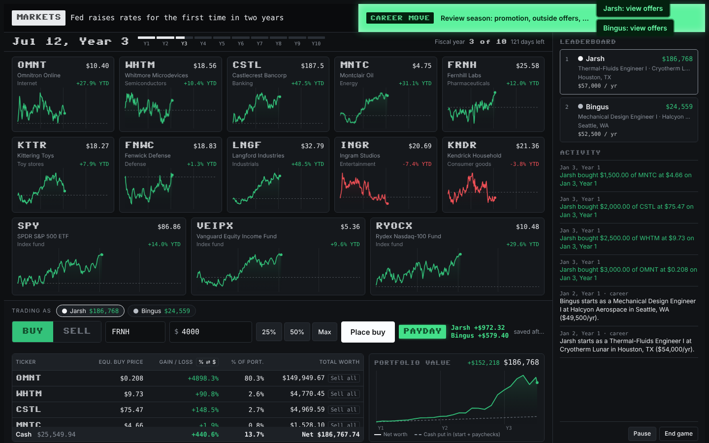
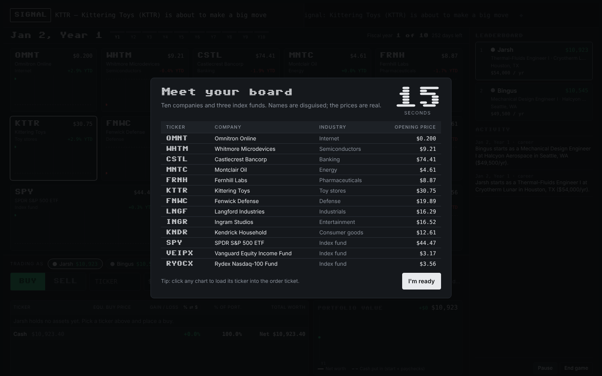
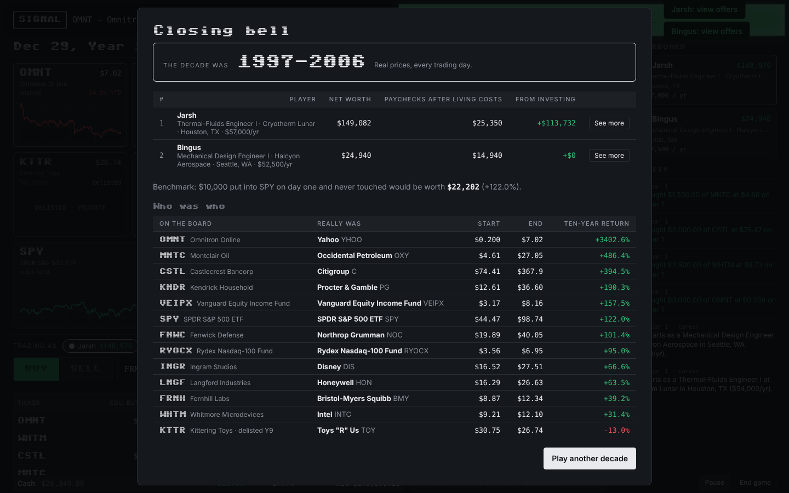

# Ten-Year Tape

**A stock market game that replays a secret, real decade of market history in about 20 minutes.**

[**▶ Play in your browser**](https://rajarshi-bose.github.io/ten-year-tape/) · No install, no account · Version 1.34

## The idea

You're handed ten years of real stock prices, but you don't know which ten years or which companies. Every chart follows actual daily closing prices. Headlines hit the tape a few trading days before the move they caused. Meanwhile you're working as an engineer, collecting paychecks, paying rent and deciding when to chase a promotion or move cities.

At the closing bell the game reveals the decade and the real company behind every fake name, so you find out whether you just survived the dot-com crash or rode Nvidia through the AI boom.

## How a game works

1. **Pick a starting job.** Each player chooses one of seven entry-level engineering jobs (test, propulsion, design, structures, manufacturing, thermal-fluids or controls), each based in a real city.
2. **Meet your board.** A 15-second intro lists the ten companies (one from each industry) and three index funds you'll be trading.
3. **Trade the decade.** Each market year plays out in two minutes. Press **B** or **S**, type a ticker and a dollar amount, and press Enter.
4. **Build a career.** Paychecks land monthly. Every 1.5–3 years you get 20 seconds to take a promotion, jump to a new company or city, or stay put.
5. **Closing bell.** Final standings split each player's net worth into what came from paychecks and what came from investing, and compare it with simply buying the S&P 500 on day one.

<table>
<tr>
<td width="50%"></td>
<td width="50%"></td>
</tr>
<tr>
<td align="center">Meet your board: 15 seconds to study the lineup</td>
<td align="center">Closing bell: the decade and every company revealed</td>
</tr>
</table>

## What makes it different

**Real market history, disguised**
- Any decade starting from 1995 to 2016, replayed day by day from actual split- and dividend-adjusted prices.
- 88 companies across ten industries, including ones that went bankrupt or were bought out, like Lehman Brothers, Enron, WorldCom and Kodak. If one fails mid-game, it delists and pays holders the final price.
- Fresh fake names and tickers every game, so you can't just buy the company you know won.
- Index funds that existed at the time: VOO, SCHD and QQQ in recent decades; SPY, DVY, Vanguard Equity Income and Rydex Nasdaq-100 in older ones.

**News that moves the market**
- About 500 written headlines covering market events from the 1997 Asian financial crisis to 2025 tariffs, plus company stories, timed to land just before the price reacts.
- Monthly and yearly recap lines, and signals before big moves the headlines don't cover.

**A realistic engineering career**
- Six-level career ladders with titles and salaries checked against current pay data, adjusted for the decade and the city.
- Promotions, outside offers and relocations across 18 US cities, from Seattle and Houston to Huntsville and Wichita.
- An optional cost-of-living mode with real tax brackets, Social Security and Medicare, state tax, local rent and food, everyday costs and lifestyle spending. Typical savings land around 10–20% of take-home pay, close to what real single earners save.

**Built for playing with friends**
- Online multiplayer: one person hosts and shares a four-letter code, friends join from their own devices, and everyone trades the same market in sync.
- Up to six players on one device, switching turns from the order ticket.
- A live leaderboard with every player's net worth, job and salary, plus an activity feed of trades and career moves.
- A portfolio value chart, holdings table with average cost and % of portfolio, and a full end-of-game breakdown of each player's career and trades.

## Playing

- **Online:** open [rajarshi-bose.github.io/ten-year-tape](https://rajarshi-bose.github.io/ten-year-tape/) in any modern browser. Works best on a laptop or desktop.
- **Offline:** download `index.html` and open it. The whole game is in that one file, with no build step or server.
- **Settings:** starting cash ($10k, $25k or $100k), year length (1, 2 or 3 minutes) and cost of living on or off.
- **Keyboard:** **B** buy, **S** sell, **P** pause, **Esc** closes windows.

### Playing online with friends

1. Everyone opens the game link and picks a name and a starting job.
2. One person clicks **Host a game** and shares the four-letter code.
3. Everyone else types the code and clicks **Join**.
4. When everyone has a job, the host rings the opening bell.

No accounts are needed. Game rooms run through a small [Firebase Realtime Database](https://firebase.google.com/docs/database), which uses ordinary secure web traffic, so it works on campus and office Wi-Fi. The host's game sets the clock for everyone, so **the host should keep their tab open** for the whole game.

## Data and sources

| What | Source |
|---|---|
| Stock and ETF prices | [sp500-data](https://github.com/Johnbrick123/sp500-data) (daily split- and dividend-adjusted closes) |
| SCHD, VEIPX and RYOCX history | Yahoo Finance |
| Rent and food by city | [MIT Living Wage Calculator](https://livingwage.mit.edu/) (HUD fair market rent) |
| Spending and savings by income | [BLS Consumer Expenditure Survey](https://www.bls.gov/cex/), one-person households |
| Engineer pay by city | BLS Occupational Employment and Wage Statistics, mechanical engineers |

Headlines are written summaries of real events, with names and identifying details changed to keep the companies anonymous until the end. The game is for fun and learning, not investment advice.

## Under the hood

- One self-contained HTML file (about 2.7 MB) with no frameworks. Charts are drawn on `<canvas>`. The only outside resources are fonts from Google Fonts and, for online play, the Firebase SDK (with [PeerJS](https://peerjs.com/) as a fallback).
- Thirty years of daily prices for 95 assets are compressed into the file and decoded on load.
- Fonts: [Sixtyfour](https://fonts.google.com/specimen/Sixtyfour) for headers, IBM Plex Sans and IBM Plex Mono for everything else.

## Versions

Every update is logged in the game. Click **Fixes** on the home screen to see what changed in each version, starting from 1.0.

---

Built by Rajarshi Bose.
